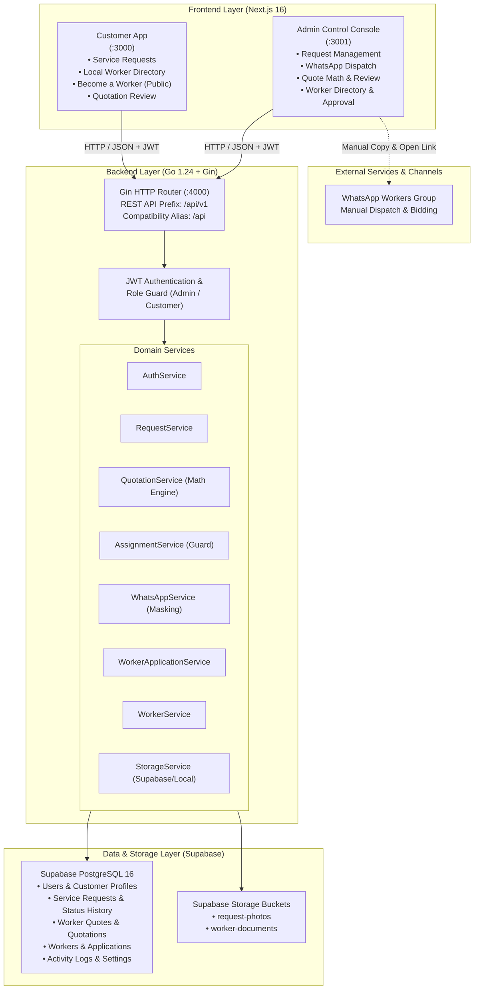
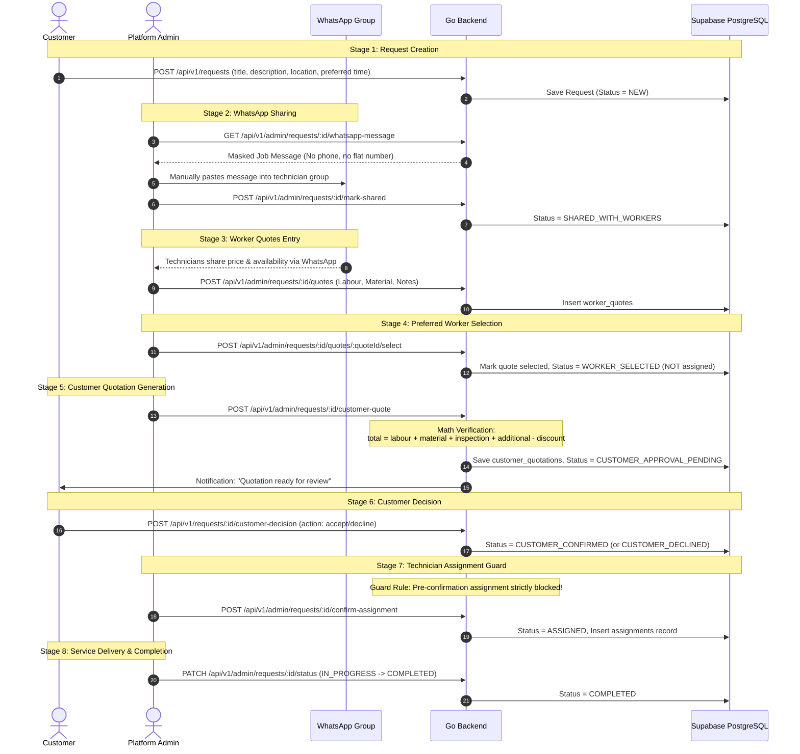

# HOMI — System Architecture & Workflow Specification

## 1. System Overview

Homi is a clean, hyper-local on-demand home services platform for Bhopal, India.
The system connects households needing repairs (plumbing, carpentry, electrical, appliances, etc.) with verified local technicians through a structured 8-stage quotation and approval workflow managed by platform administrators.

---

## 2. Technology Stack

| Layer | Component | Specification |
| :--- | :--- | :--- |
| **Backend** | Language | Go (Golang 1.24+) |
| | Framework | Gin (`github.com/gin-gonic/gin`) |
| | ORM | GORM (`gorm.io/gorm` + `gorm.io/driver/postgres`) |
| | Port | `4000` |
| | Primary API Prefix | `/api/v1` |
| | Compatibility Alias | `/api` |
| | Password Hashing | Dual format: standard `bcrypt` & legacy Node.js `scrypt` |
| | Auth Tokens | Standard JWT (`github.com/golang-jwt/jwt/v5`) |
| **Database & Infrastructure** | Database Engine | Supabase PostgreSQL 16 |
| | Object Storage | Supabase Storage (fallback: local static `./uploads`) |
| **Frontend** | Customer App | Next.js 16 + React 19 + TypeScript (Port `3000`) |
| | Admin Panel | Next.js 16 + React 19 + TypeScript (Port `3001`) |
| | Worker Access | **Public Application Form only** (No separate worker app or portal) |

---

## 3. Strict 8-Stage Business Lifecycle

---

## 4. Privacy & Security Rules

1. **Customer Data Masking**: WhatsApp job messages strip house/flat numbers and customer phone numbers. Only problem description, service category, and general neighborhood/city are broadcast.
2. **Worker Portal Elimination**: In accordance with platform governance, there is no worker portal, worker login, or worker app. Technician engagement is conducted via WhatsApp and phone dispatch.
3. **Public Worker Application**: Prospective technicians apply via public Become a Worker form (`/become-a-worker`). Submissions are saved as `PENDING` in `worker_applications`. Admin review creates a record in `workers` without credentials.
4. **Assignment Guard**: The backend strictly blocks assigning a technician prior to customer confirmation (`CUSTOMER_CONFIRMED`).
